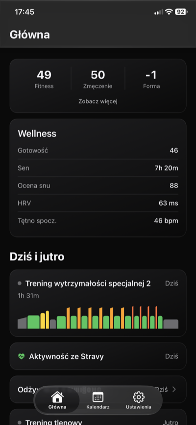
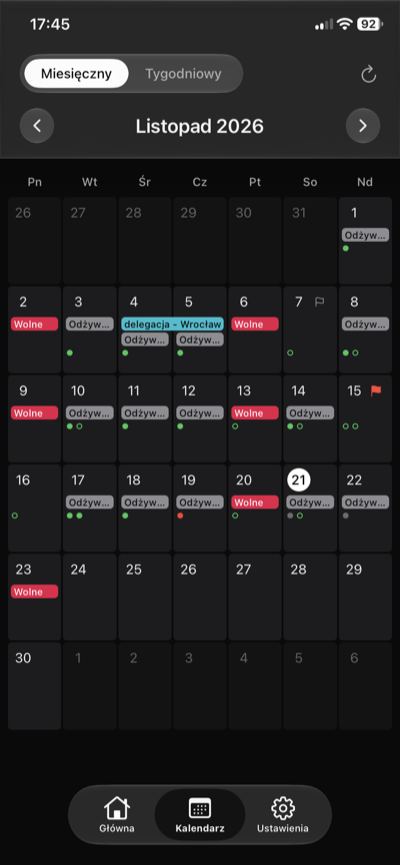
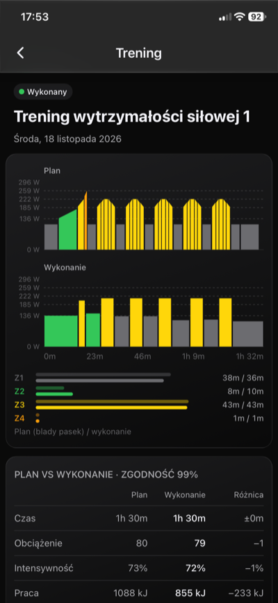
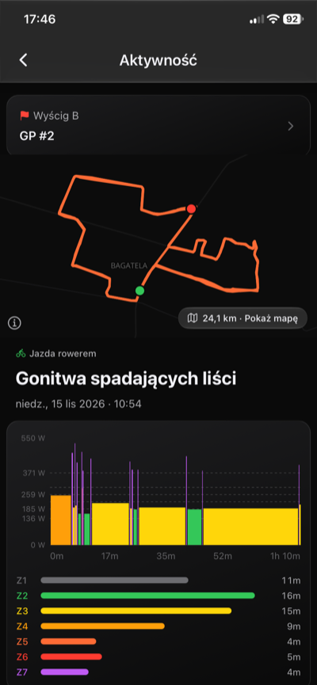

# BH Cycling

A cycling training app for iOS and Android, built on top of [Intervals.icu](https://intervals.icu). It shows the athlete's planned Workouts, recorded Activities, Races, Notes, fitness and wellness in a phone-first, dark UI with Polish labels.

  
  
  
  

## Features

- **Home:** fitness, fatigue and form, today's wellness, and the Workouts for today and tomorrow, each with its Workout Profile.
- **Calendar:** month and week views of Workouts, Activities, Races and Notes, with a sheet for each day.
- **Workout Details:** the planned Workout Profile next to the ridden Activity Profile, on one time scale, with Time in Zone, plan against actual, and every step.
- **Activity Details:** rides with no Workout behind them, including Races, with a route map, power profile and summary.
- **Intervals.icu connection:** OAuth sign-in to Intervals.icu, with the token exchange and storage kept server-side.
- **Account:** email and Google sign-in, email verification, password change and account deletion.

## Stack

- **App:** Expo SDK 57, React Native 0.86, React 19, TypeScript, Expo Router, React Compiler
- **Data:** TanStack Query over the Intervals.icu API, Valibot for parsing responses, React Hook Form for forms
- **UI:** Expo UI bottom sheets, MapLibre with OpenFreeMap tiles, Reanimated, sonner-native toasts
- **Backend:** Firebase Auth, Firestore and Cloud Functions, in separate staging and production projects
- **Delivery:** EAS Build and EAS Update, with releases driven by GitHub Actions

## How it's built

- **Specs before code:** every feature starts as a spec issue, which is sliced into tickets and linked from its PR. PRs carry labels for type, size, area and how they ship.
- **Shared language:** [`CONTEXT.md`](CONTEXT.md) is the domain glossary (Workout, Activity, Workout Profile, ...). Code, issues and UI copy use the same terms.
- **Recorded decisions:** [`docs/adr/`](docs/adr/) holds the architecture decisions, such as no `useEffect`, no comments and no type assertions.
- **Tests where they pay:** Jest covers the business logic. End-to-end tests cover user flows on real staging, on iOS and Android.
- **Agent-assisted:** most of the work is done with AI coding agents, guided by [`CLAUDE.md`](CLAUDE.md), [`CODING_STANDARDS.md`](CODING_STANDARDS.md) and [`docs/agents/`](docs/agents/).
- **Release flow:** `main` ships to a Dev build, `rc/X.Y.Z` to staging (TestFlight and Play internal testing), and `vX.Y.Z` tags to the stores. Fixes ship over the air when native code hasn't changed.

## Development

Setup, running the app, Cloud Functions and releasing are covered in [`docs/development.md`](docs/development.md).

## License

The source is public for portfolio purposes. All rights reserved: no licence is granted to copy, modify or distribute it.
